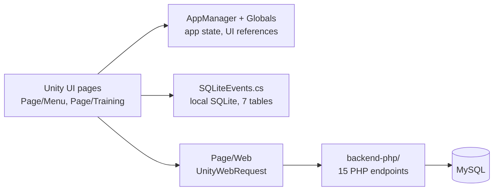

# Gym Tracker – Unity mobile app prototype

A mobile app to plan and log gym workouts, built solo in **Unity (C#)** between 2021 and 2023, with a local **SQLite** database and a small **PHP/MySQL** backend. It is an unfinished prototype: I stopped working on it while it was still not stable enough to release.

## At a glance

| | |
|---|---|
| **What it does** | Create workout plans, browse an exercise library by muscle group, run a session that logs sets, reps, weight and rest times |
| **Size** | ~8,800 lines of my own C# (~7,600 without blank lines and comments) in 39 scripts |
| **Local data** | SQLite, 7 tables, all queries in one class |
| **Online data** | 15 PHP endpoints that serve a shared exercise library from MySQL |
| **Stack** | Unity 2021.3, C#, SQLite (Mono.Data.Sqlite), TextMesh Pro, PHP, MySQL |

## How it fits together

## Where to look

| Area | File | What it does |
|---|---|---|
| Startup | [`Globals/Init.cs`](Assets/C%23/Globals/Init.cs) | Finds the UI objects and wires every button |
| Local database | [`Utility/Database/SQLite.cs`](Assets/C%23/Utility/Database/SQLite.cs) | Opens the database and creates the 7 tables |
| | [`Utility/Database/SQLiteEvents.cs`](Assets/C%23/Utility/Database/SQLiteEvents.cs) | All reads and writes (plans, exercises, sessions) |
| Workout session | [`Page/Training/Allenamento.cs`](Assets/C%23/Page/Training/Allenamento.cs) | Runs a workout: current exercise, sets, rest timer |
| | [`Page/Training/Finito.cs`](Assets/C%23/Page/Training/Finito.cs) | "Workout finished" summary |
| Exercises and plans | [`Page/Menu/Esercizi.cs`](Assets/C%23/Page/Menu/Esercizi.cs), [`Page/Menu/Schede.cs`](Assets/C%23/Page/Menu/Schede.cs) | Exercise library and workout plans |
| Online library | [`Page/Web/dbWeb.cs`](Assets/C%23/Page/Web/dbWeb.cs), [`Page/Web/DownloadWeb.cs`](Assets/C%23/Page/Web/DownloadWeb.cs) | Calls the PHP endpoints and saves the results locally |
| Backend | [`backend-php/`](backend-php) | One PHP file per endpoint, prepared statements |

## Database (SQLite)

| Table | Meaning | Main columns |
|---|---|---|
| `scheda` | workout plan | name |
| `dettagli` | an exercise inside a plan | sets, reps, rest, position, exercise, plan |
| `esercizio` | exercise | name, tips, notes, image |
| `muscolo` | muscle group | name |
| `m_e` | exercise–muscle link | exercise, muscle |
| `allenamento` | a workout session | date, duration, finished, plan |
| `attivita` | a set performed in a session | set, reps, weight, rest |

Identifiers and comments are in Italian. Quick glossary: *scheda* = plan, *esercizio* = exercise, *allenamento* = workout, *recupero* = rest, *serie* = set, *ripetizioni* = reps, *peso* = weight.

## Status and known gaps

- Prototype: the statistics screen is not implemented and there are no automated tests.
- The app relies on a large static `Globals` class.
- The server address in the code is a placeholder (`your-server.example`); the online features need your own server and a `ConnectionSettings.php` file, which is not included.

If I rebuilt it, I would split the `Globals` class into smaller services, put the server address in one configuration file, and add tests for the database layer.

## What I learned

- Designing a relational database and querying it from C#
- Building a multi-screen mobile UI in Unity
- Building a simple client-server setup (Unity app + PHP/MySQL API)
- Why code structure and security matter once a project grows

## History

- 2021–2023: built the app.
- 2026: cleaned it up for publication

## Run it

Open the folder with Unity 2021.3.3f1 and load `Assets/Scenes/MainScene.unity`. Third-party code included: SimpleJSON, NativeGallery and a B2.NET sample (in `Assets/Plugins` and `Assets/C#/Utility/SimpleJSON.cs`).
